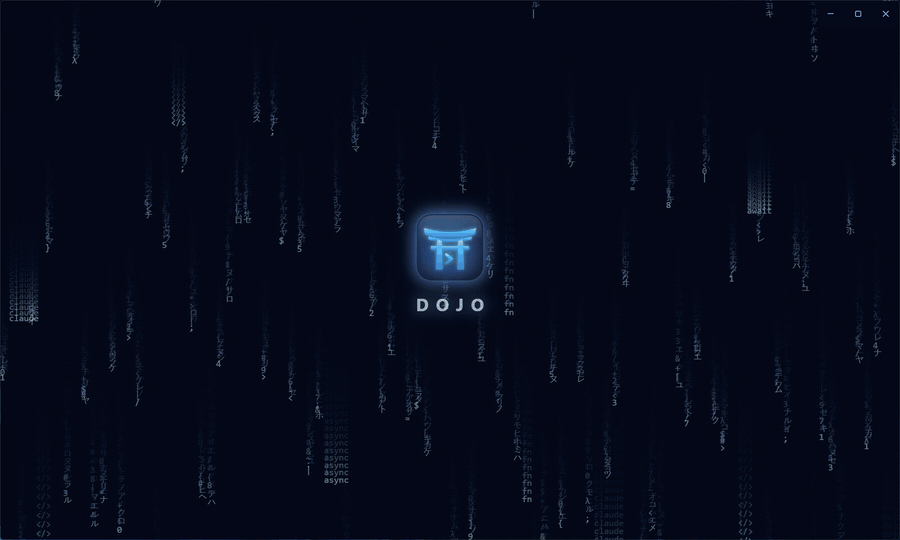
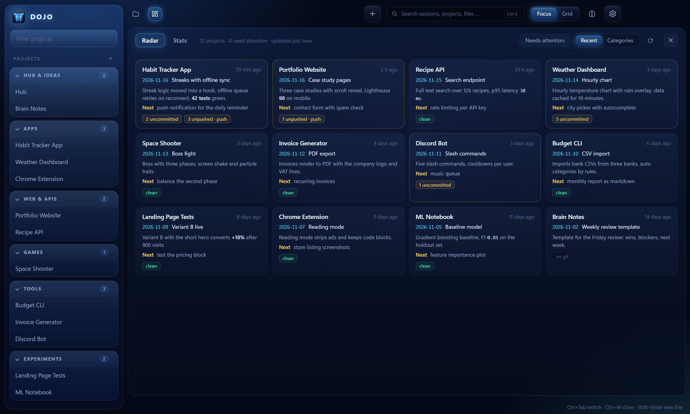
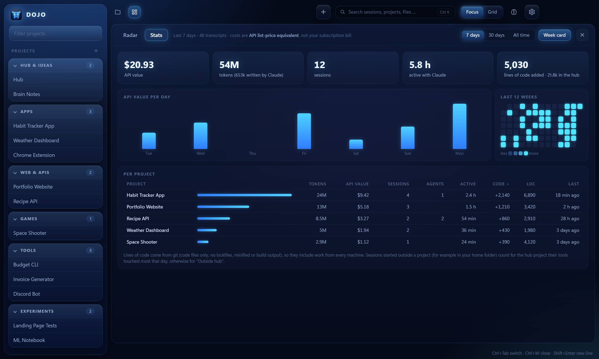
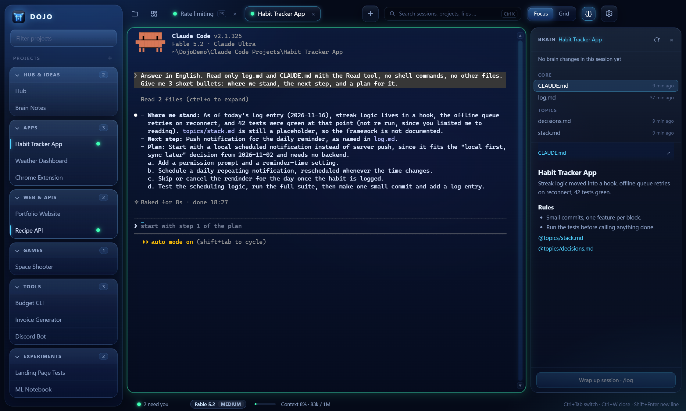
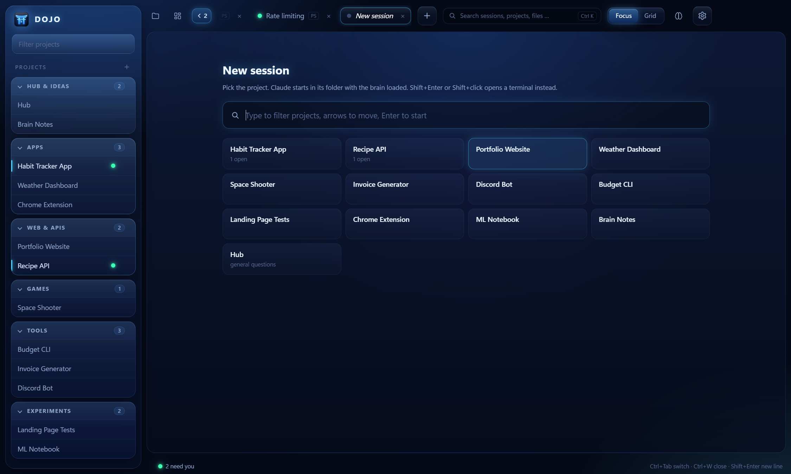
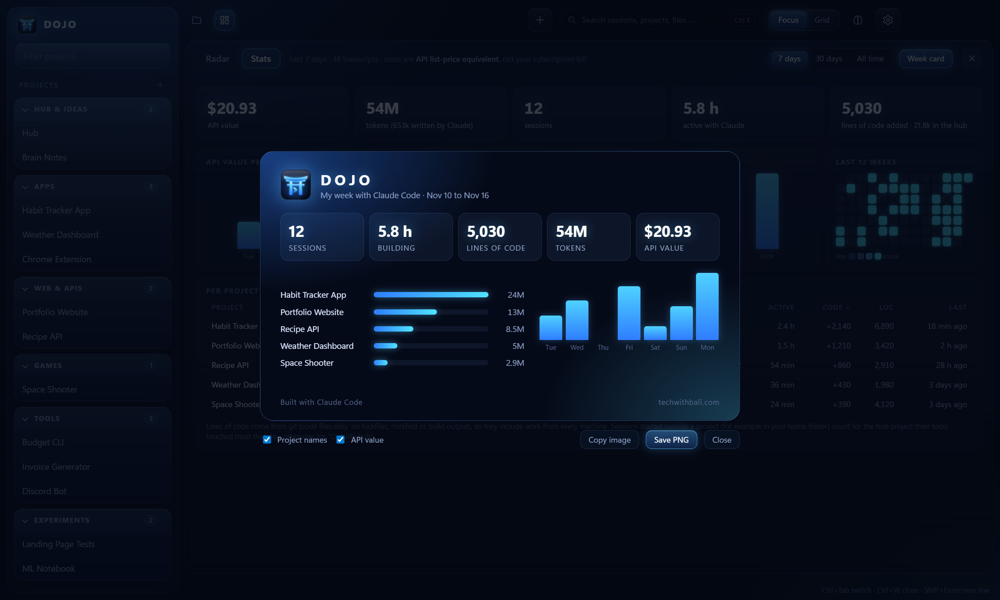

# Dojo

**A desktop cockpit for Claude Code.** Every project in your hub folder becomes a card. One click opens Claude in that
folder with its `CLAUDE.md` loaded, many sessions run side by side in tabs or a grid, and you always see which one
needs you, what each project is waiting for and what your week with Claude looked like.



Built for people who run several Claude Code projects at once and lose track of terminals, context and unpushed work.
Windows first, works on macOS.

## What it does

| | |
|---|---|
| **Sessions in tabs or a grid** | Live status per tab (working, waiting for you, needs approval), desktop notifications, restore on restart. |
| **New session page** | `+` or `Ctrl+T` opens a project picker. Tabs name themselves after your first prompt. |
| **Hub radar** | One card per project: last log entry, the next step, uncommitted and unpushed work, one-click `git push`. |
| **Stats** | Tokens, API-price value, sessions, active hours and lines of code per project, 12-week heatmap. |
| **Week card** | A shareable PNG of your week with Claude Code, with toggles to hide project names or money. |
| **Model, effort, context** | The status bar shows model, effort and how full the context window is. From 40% a button hands off to a fresh session via `HANDOFF.md`. |
| **Brain panel** | Your `CLAUDE.md`, topics and log next to the terminal, with what changed in this session and a one-click `/log` wrap-up. |
| **Side question tab** | `Ctrl+Shift+Q` opens a throwaway Sonnet session, so quick questions do not bloat your work session. |

## Screenshots

**Hub radar**: every project at a glance, with what needs attention.


**Stats**: tokens, API value, active time and lines of code per project.


**A session**: Claude in the project folder, brain panel on the right, model, effort and context at the bottom.


**New session**: pick a project, Claude starts there with its brain loaded.


**Week card**: share your week.


## Install

You need:

- **Node.js 20 or newer** ([nodejs.org](https://nodejs.org))
- **git**
- **Claude Code** installed and logged in, so `claude` runs in a terminal ([docs](https://docs.claude.com/en/docs/claude-code))

Then:

```bash
git clone https://github.com/balazsarany9619/dojo-for-claude-code.git
cd dojo-for-claude-code/app
npm install
npm start
```

`npm install` builds the terminal backend (`node-pty`). On Windows this works out of the box with prebuilt binaries;
if it fails, install the "Desktop development with C++" workload of the Visual Studio Build Tools and run it again.

### Point Dojo at your projects

By default Dojo uses `~/Desktop/Claude Code Projects` as the hub: every subfolder becomes a project. To use another
folder, copy `app/config.example.json` to your user data folder as `config.json` and set `hub`:

- Windows: `%APPDATA%\dojo\config.json`
- macOS: `~/Library/Application Support/dojo/config.json`

```json
{
  "hub": "~/code",
  "extra": [{ "name": "Home (~)", "path": "~" }],
  "categories": [
    { "name": "Apps", "projects": ["my-app", "my-api"] },
    { "name": "Websites", "projects": ["portfolio"] }
  ]
}
```

`extra` adds folders outside the hub, `categories` groups the sidebar (names must match folder names).

### Optional: exact live status

Without hooks Dojo guesses each tab's status from terminal activity. For exact status, register
`app/tools/dojo-hook.sh` as a Claude Code hook (SessionStart, UserPromptSubmit, PostToolUse, Stop, Notification)
in `~/.claude/settings.json`.

### Optional: a project brain

Dojo works with any folder, and it shines with a small "brain" per project: a `CLAUDE.md` with the rules,
a `log.md` with dated entries (`## 2026-11-16: what happened` plus a `- Next: ...` line) and a `topics/` folder.
The radar reads the newest log entry and the Next line, the brain panel shows the files.

## Keys

| Key | Action |
|---|---|
| `Ctrl+T` | New session page |
| `Ctrl+K` | Search sessions, projects, files and actions |
| `Ctrl+Shift+H` | Hub (radar and stats) |
| `Ctrl+Shift+B` | Brain panel |
| `Ctrl+Shift+Q` | Side question on Sonnet |
| `Ctrl+Tab`, `Ctrl+W` | Switch and close tabs |
| `Ctrl+1`, `Ctrl+2` | Focus or grid view |

On macOS use `Cmd` instead of `Ctrl`.

## Notes

- Stats are computed locally from the transcripts Claude Code writes to `~/.claude/projects`. Nothing leaves your machine.
- Costs are shown as the **API list-price equivalent** of your usage, not your subscription bill.
- Dojo never deletes or renames folders. Creating a new project only adds a folder.

## License

MIT. Built with Claude Code by [Tech with Bali](https://techwithbali.com).
